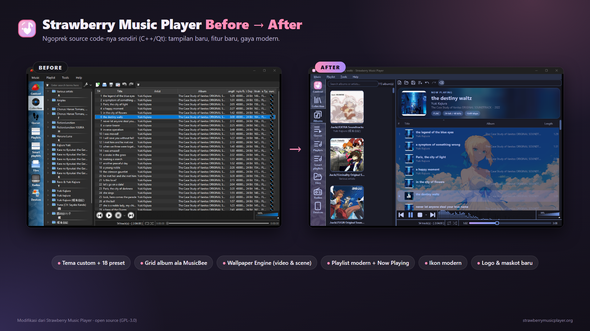

# :strawberry: Stabewwy

**Stabewwy** is a personal fork of [Strawberry Music Player](https://github.com/strawberrymusicplayer/strawberry) with a
fully customizable, modern look and a few features inspired by other music players like MusicBee and Spotify:
an album cover grid, a modern playlist with a "now playing" card, themes, modern icons and animated backgrounds
from Wallpaper Engine.

Everything Strawberry does (collection management, gapless playback, bit-perfect output, tag editing, scrobbling,
streaming services, ...) still works the same, this fork only adds on top of it.



> [!NOTE]
> This is an **unofficial fork**, it's not affiliated with or supported by the Strawberry developers.
> Please don't report problems with this fork to the Strawberry project, open an issue here instead.

---

## :sparkles: What's new

### :art: Themes
- **Tools → Customize appearance**: a live theme editor, changes are applied right away.
- 18 presets: pastel ones (Sakura Pink, Lavender Dream, Mint Soda, Peach Cream, Sky Blue, Midnight Kawaii) and dark
  ones (Graphite, OLED Black, Nord, Dracula, Tokyo Night, Catppuccin Mocha, Gruvbox Dark, Forest, Crimson Night,
  Ocean Deep, Sunset Dark, Monochrome).
- Or pick your own accent, secondary accent, window, list and text colors, and the corner roundness.

### :framed_picture: Modern icons and branding
- Modern monochrome outline icons that follow the theme's text color (the play button uses the accent color).
  The colorful pastel icon set is still available.
- A new logo, app icon and a cat mascot instead of the strawberry.

### :cd: Album grid
- A new **Albums** tab showing your collection as a grid of covers, MusicBee style.
- Search by album or artist, double-click (or Enter) to play an album, right-click to add it to the playlist or open
  it in a new one, or drag it to the playlist.
- The sidebar widens while the tab is open and remembers the width you give it.

### :notes: Modern playlist
- Rows with the album cover, the title and the artist on two lines, and only the useful columns
  (#, title, album, length; the others can still be shown from the header's context menu).
- Rounded hover and selection, and an animated equalizer on the playing song.
- A **now playing** card above the playlist: big cover on a blurred background, title, artist, album, year and the
  audio format (e.g. `FLAC · 24-bit / 48 kHz · 1649 kbps`).
- Can be turned off in Customize appearance to get the classic table back.

### :sunrise_over_mountains: Backgrounds and Wallpaper Engine
- The playlist and the album grid each have their own background: none, the cat mascot, an image (PNG, JPEG, WebP,
  ...), the cover of the playing album, or a **video** that plays muted in a loop.
- **Choose from Wallpaper Engine**: lists all the wallpapers you have in [Wallpaper Engine](https://store.steampowered.com/app/431960/Wallpaper_Engine/)
  (Steam workshop and your own projects, in all Steam libraries).
  - Video wallpapers play animated.
  - For scene wallpapers the main image is extracted from `scene.pkg` in full resolution (still image, the scene's
    effects need Wallpaper Engine itself).
  - Web wallpapers use their preview image.
- Opacity, blur and size options. Videos pause by themselves while the window is minimized.
- Picked images are copied into Strawberry's data folder, so backgrounds keep working when the original file goes
  away (e.g. an online-only OneDrive file).

---

## :computer: Building on Windows

Requirements (one time):

1. [Visual Studio 2022 Build Tools](https://visualstudio.microsoft.com/downloads/) with the C++ workload and
   Windows SDK 10.0.22621, CMake and Ninja:
   ```
   winget install Microsoft.VisualStudio.2022.BuildTools
   winget install Kitware.CMake
   winget install Ninja-build.Ninja
   ```
2. The prebuilt dependencies: download `strawberry-msvc-x86_64-release.tar.xz` from
   [strawberry-msvc-dependencies](https://github.com/strawberrymusicplayer/strawberry-msvc-dependencies/releases)
   and extract it to `C:\` (giving `C:\strawberry_msvc_x86_64_release`), or set `STRAWBERRY_DEPS` to where you put it.

Then build:

```
git clone git@github.com:saikanov/stabewwy.git
cd stabewwy
tools\windows\build.bat
```

The first build takes a while, later builds only recompile what changed. Start `build\strawberry.exe`
(the DLLs and plugins it needs are copied next to it). See [tools/README.md](tools/README.md) for more, including how
to change the icons.

On Linux and macOS the regular Strawberry build instructions apply (`cmake -S . -B build && cmake --build build`),
the Wallpaper Engine picker is Windows only.

---

## :arrows_counterclockwise: Staying up to date with Strawberry

This fork tracks Strawberry's `master` branch. To pull in new upstream changes:

```
git remote add upstream https://github.com/strawberrymusicplayer/strawberry
git pull upstream master
```

---

## :heart: Credits

- [Strawberry Music Player](https://www.strawberrymusicplayer.org) by Jonas Kvinge and contributors, itself
  originally forked from [Clementine](https://www.clementine-player.org). All the hard work is theirs.
  If you like it, consider [supporting Strawberry's development](https://github.com/sponsors/jonaski).
- The modern icons are inspired by [Lucide](https://lucide.dev) (ISC license).
- Wallpaper Engine is made by the Wallpaper Engine Team, this fork only reads the wallpapers you
  already have installed.

## :scroll: License

Like Strawberry, Stabewwy is free software released under the [GNU General Public License v3.0](COPYING).
